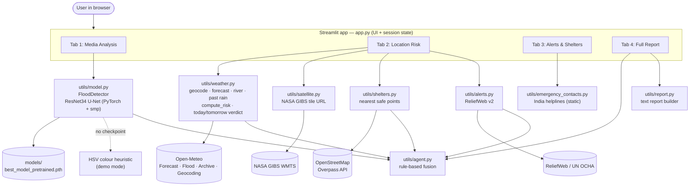

# 🌊 FloodGuard AI

A Streamlit web app that combines **computer-vision flood detection** with **live weather, river, satellite and official-alert data** to produce one flood-risk picture for a location — plus nearest safe places, emergency contacts, and a downloadable report.

> ⚠️ **Not a substitute for official emergency guidance.** Always verify with local disaster authorities (NDMA / SDMA / district control rooms) before acting.

---

## Table of contents

1. [Features](#1-features)
2. [Architecture](#2-architecture)
3. [Tech stack](#3-tech-stack)
4. [Project structure](#4-project-structure)
5. [How it works (end to end)](#5-how-it-works-end-to-end)
6. [Prerequisites](#6-prerequisites)
7. [Run locally — step by step](#7-run-locally--step-by-step)
8. [Environment variables / API keys (`.env`)](#8-environment-variables--api-keys-env)
9. [Using the app](#9-using-the-app)
10. [Scoring logic reference](#10-scoring-logic-reference)
11. [External services used](#11-external-services-used)
12. [Troubleshooting](#12-troubleshooting)
13. [Known limitations](#13-known-limitations)
14. [Roadmap](#14-roadmap)
15. [Git & sharing the model file](#15-git--sharing-the-model-file)

---

## 1. Features

| Tab | What it does |
|---|---|
| **📷 Media Analysis** | Upload an image (`jpg/jpeg/png`) or video (`mp4/mov/avi`). A ResNet34 U-Net segments each pixel into 10 classes, computes flooded-area %, severity, and shows a colour overlay. For video, ~12 evenly spaced frames are analysed and the worst frame is shown with a flood-coverage line chart. |
| **📍 Location Risk** | Pick a place by **name search** or by **clicking on a map** (optional NASA satellite layer). Fetches rainfall forecast, river-discharge trend, past-7-day rainfall and official alerts → 0–100 risk score, today/tomorrow verdict, charts and a results map with shelter markers. |
| **🚨 Alerts & Shelters** | Nearest safe locations (shelters, hospitals, schools, places of worship, etc.) from OpenStreetMap, official flood reports from ReliefWeb, and India national emergency numbers. |
| **📄 Full Report** | Fuses image/video result + location risk + alerts into one final score and verdict, shows the reasoning trail, and offers a `.txt` report download. |

If the model checkpoint is missing, the app falls back to a simple **HSV colour heuristic ("demo mode")** and clearly warns you.

---

## 2. Architecture



**Design principles (as implemented in the code)**

- **Everything is transparent and rule-based.** The risk score and the fusion step are plain formulas you can read in `utils/weather.py` and `utils/agent.py` — there is no LLM and no black box in the decision layer.
- **Graceful degradation.** Each external call is wrapped so a failure (network, rate limit, missing key) returns an empty result instead of crashing the app.
- **Privacy-friendly.** Uploaded images/videos are processed locally on your machine. Only latitude/longitude (and place-search text) are sent to third-party APIs. Videos are written to a temporary file that is deleted after analysis.
- **State** is kept in `st.session_state`, and the model is loaded once via `@st.cache_resource`.

---

## 3. Tech stack

| Layer | Technology |
|---|---|
| UI | Streamlit, custom CSS (`assets/style.css`, dark glassmorphic theme), `streamlit-folium` + Folium maps |
| Computer vision | PyTorch, `segmentation-models-pytorch` (U-Net, ResNet34 encoder), OpenCV (headless), NumPy |
| Data / APIs | `requests` → Open-Meteo, NASA GIBS, OpenStreetMap Overpass, ReliefWeb |
| Config | `python-dotenv` (optional, only for the ReliefWeb appname) |

---

## 4. Project structure

```
floodguard-ai-v2/
├── app.py                        # Streamlit UI: 4 tabs, sidebar, session state
├── requirements.txt              # Python dependencies
├── README.md
├── .gitignore
├── .env.example                  # template for your private .env
├── .streamlit/
│   └── config.toml               # dark theme colours
├── assets/
│   └── style.css                 # animated dark glassmorphic styling
├── models/
│   ├── best_model_pretrained.pth # trained checkpoint (~94 MB) — see section 15
│   └── PUT_MODEL_HERE.txt        # reminder of the expected filename
└── utils/
    ├── __init__.py
    ├── model.py                  # FloodDetector, class names, colorize_mask
    ├── weather.py                # geocode, forecast, river, past rain, risk scoring
    ├── shelters.py               # Overpass query + haversine distance
    ├── alerts.py                 # ReliefWeb v2 flood reports
    ├── satellite.py              # NASA GIBS tile URL
    ├── emergency_contacts.py     # India national helplines
    ├── agent.py                  # weighted fusion of all signals
    └── report.py                 # downloadable .txt report
```

---

## 5. How it works (end to end)

### Flow A — Media analysis (Tab 1)

1. User uploads an image or video and clicks **Analyze media**.
2. `FloodDetector.predict()` resizes the frame to **256×256**, scales to 0–1, runs the U-Net, and takes `argmax` per pixel → a class-id mask.
3. Flooded pixels = classes **1 (Building-flooded), 3 (Road-flooded), 5 (Water)**. `flood_pct` = flooded pixels ÷ total pixels × 100.
4. Severity is derived from `flood_pct` (see [section 10](#10-scoring-logic-reference)); a colour overlay is blended over the original.
5. **Video:** every `frame_count // 12`-th frame is analysed; the average and peak coverage are shown and the **most-flooded frame** is stored as the result.
6. The result is saved in `st.session_state.cv_result` for the Full Report tab.

The 10 classes: `Background, Building-flooded, Building-non-flooded, Road-flooded, Road-non-flooded, Water, Tree, Vehicle, Pool, Grass`.

### Flow B — Location risk (Tab 2)

1. User searches a place (Open-Meteo geocoding, top result) **or** clicks the map → `(lat, lon)` is stored.
2. On **Analyze this location**, the app calls, in order: Open-Meteo forecast (5 days) → Open-Meteo Flood API (river discharge, 7 days) → ReliefWeb alerts → `compute_risk()` → Overpass shelters → Open-Meteo Archive (past 7 days) → today/tomorrow verdict.
3. The UI shows the risk banner, today/tomorrow cards, rain/probability/river metrics, past-7-day and 5-day bar charts, and a results map (risk circle + shelter markers).

### Flow C — Fusion & report (Tab 4)

`fuse_assessment()` takes whichever signals exist (media, weather, alerts), computes a weighted average, produces a verdict and reasoning trail, and picks the nearest shelter. `build_report()` turns everything into a downloadable text file (`floodguard_report.txt`).

---

## 6. Prerequisites

| Requirement | Notes |
|---|---|
| **Python 3.10 – 3.12** | The project was built on 3.11. |
| **pip** | Comes with Python. |
| **Git** | Only if you clone from a repository. |
| **~3 GB free disk** | PyTorch is large. |
| **Internet connection** | Needed for all live data, map tiles, and fonts. |
| **Trained checkpoint** | `models/best_model_pretrained.pth` (included in the project zip). |
| GPU | **Optional.** CUDA is auto-detected; CPU works fine for single images. |

---

## 7. Run locally — step by step

### Step 1 — Get the project

```bash
# From the zip
unzip floodguard-ai-v2.zip
cd floodguard-ai-v2

# OR from Git
git clone <your-repo-url>
cd floodguard-ai-v2
```

### Step 2 — Create and activate a virtual environment

**macOS / Linux**
```bash
python3 -m venv venv
source venv/bin/activate
```

**Windows (PowerShell)**
```powershell
python -m venv venv
venv\Scripts\Activate.ps1
```

**Windows (CMD)**
```cmd
python -m venv venv
venv\Scripts\activate.bat
```

> PowerShell blocked the script? Run `Set-ExecutionPolicy -Scope CurrentUser RemoteSigned` once, then retry.

### Step 3 — Install dependencies

```bash
pip install --upgrade pip
pip install -r requirements.txt
```

This installs Streamlit, Folium, PyTorch, segmentation-models-pytorch, OpenCV, NumPy, requests and python-dotenv. The PyTorch download is large — be patient.

*(Optional, smaller install for CPU-only machines: follow the selector at <https://pytorch.org/get-started/locally/> to install the CPU build of `torch` first, then run the command above.)*

### Step 4 — Place the model checkpoint

Make sure this exact file exists:

```
models/best_model_pretrained.pth
```

If you received the project as a zip it is already there. If you cloned from Git (the `.gitignore` excludes weights), copy it in:

```bash
cp /path/to/best_model_pretrained.pth models/
```

The filename must match exactly, because `app.py` loads `models/best_model_pretrained.pth`.

### Step 5 — Configure `.env` (optional)

```bash
cp .env.example .env          # Windows CMD: copy .env.example .env
```

Then edit `.env` — see [section 8](#8-environment-variables--api-keys-env). **You can skip this step**; the app runs without it (you just won't get ReliefWeb official alerts).

### Step 6 — Start the app

Run from the project root (the folder containing `app.py`) so the relative `models/` and `assets/` paths resolve:

```bash
streamlit run app.py
```

Streamlit prints a local URL. Open **<http://localhost:8501>** in your browser.

### Step 7 — Verify it works

- Sidebar shows **"CV model: Trained model loaded"** with a green dot.
  - Orange dot / yellow banner = checkpoint not found → demo mode (see [Troubleshooting](#12-troubleshooting)).
- Tab 2 → search `Hyderabad` → **Search this place** → **Analyze this location** → a risk banner and charts appear.

To stop the app press `Ctrl + C` in the terminal. To run on a different port: `streamlit run app.py --server.port 8600`.

---

## 8. Environment variables / API keys (`.env`)

**Short version: this project needs no API keys to run.** Open-Meteo, NASA GIBS, OpenStreetMap Overpass and the geocoder are all free and keyless.

There is exactly **one** optional credential:

| Variable | Required? | Used by | Purpose |
|---|---|---|---|
| `RELIEFWEB_APPNAME` | Optional | `utils/alerts.py` | ReliefWeb (UN OCHA) API v2 requires a **pre-approved `appname`** on every request. Without it the Alerts feature returns nothing. |

### Getting a ReliefWeb appname

1. Open <https://apidoc.reliefweb.int/parameters#appname> and read the guidance on choosing an appname (it should be specific and hard to guess, not a generic word).
2. Submit the appname request form. It is free.
3. ReliefWeb reviews the request and **emails you the approved string**. This can take some time.
4. Put it in `.env`:

```env
RELIEFWEB_APPNAME=your-approved-appname-here
```

5. Restart Streamlit (`Ctrl + C`, then `streamlit run app.py`).

### Alternative: set it in your shell instead of a file

```bash
# macOS / Linux
export RELIEFWEB_APPNAME="your-approved-appname"
# Windows PowerShell
$env:RELIEFWEB_APPNAME="your-approved-appname"
```

### Rules for `.env`

- No quotes and no spaces around `=` are needed: `KEY=value`.
- It is loaded by `python-dotenv` from the project folder.
- **Never commit `.env`** — it is in `.gitignore`. Only `.env.example` (with no real value) belongs in Git.

> **Why this matters:** the original code called ReliefWeb's **v1** endpoint with an unregistered name (`floodguard-ai`). ReliefWeb has decommissioned v1 and enforces approved appnames on v2 since 1 Nov 2025, so those calls fail — and because errors were swallowed silently, the app just showed "no alerts". The included `utils/alerts.py` uses v2 + `RELIEFWEB_APPNAME` and prints a clear console message when the key is missing or rejected.

---

## 9. Using the app

**Analyse a photo/video**
1. Tab **📷 Media Analysis** → choose *Image* or *Video* → upload → **🔍 Analyze media**.
2. Read the verdict, severity, flooded-area %, overlay, and class breakdown.

**Check a location**
1. Tab **📍 Location Risk** → choose *Search by name* or *Click on map*.
2. (Optional) tick **🛰️ Show satellite layer** (NASA MODIS true-colour, ~1 day old, for visual reference only).
3. Click **⚡ Analyze this location**.

**See shelters, alerts, contacts** → tab **🚨 Alerts & Shelters** (shelters/alerts appear after a location analysis; contacts are always shown).

**Get the combined result** → tab **📄 Full Report** → review the final score and reasoning → **⬇ Download full report (.txt)**.

---

## 10. Scoring logic reference

### Image severity (`utils/model.py`)

| Flooded area | Severity |
|---|---|
| < 3 % | No flooding detected |
| 3 – 15 % | Low |
| 15 – 35 % | Moderate |
| 35 – 60 % | High |
| ≥ 60 % | Severe |

The Media tab headline verdict uses: ≥ 15 % → *Flood detected*, ≥ 3 % → *Possible flooding*, else *No flooding detected*.

### Location risk score (`utils/weather.py → compute_risk`)

```
rain_score      = min(60, next_48h_rain_mm / 150 × 60)     # sum of today + tomorrow
prob_score      = max_rain_probability(today, tomorrow) / 100 × 20
discharge_score = min(20, max(0, river_trend × 40))        # trend = (last − first) / max(first, 1) over 7-day forecast
forecast_score  = min(100, rain_score + prob_score + discharge_score)

if official_flood_reports_exist:   risk = max(forecast_score, 65)   # "active-alert floor"
```

| Score | Level |
|---|---|
| < 20 | Low |
| 20 – 45 | Moderate |
| 45 – 70 | High |
| ≥ 70 | Severe |

### Today / tomorrow verdict

| Condition (checked in order) | Verdict |
|---|---|
| Official alert present | Likely — active flooding already reported |
| Rain ≥ 50 mm, or ≥ 25 mm with ≥ 80 % probability | Likely — heavy rain expected |
| Rain ≥ 15 mm, or probability ≥ 70 % with river rising > 3 % | Possible — watch conditions |
| Rain ≥ 5 mm or probability ≥ 50 % | Unlikely, but some rain expected |
| otherwise | Not expected |

### Final fusion (`utils/agent.py`)

| Signal | Weight | Value used |
|---|---|---|
| Image/video severity | 0.5 | No flooding 0 · Low 25 · Moderate 55 · High 80 · Severe 100 |
| Weather/river risk | 0.4 | `risk_score` (0–100) |
| Official alerts | 0.1 | `min(100, number_of_alerts × 20)` |

`final_score = Σ(value × weight) ÷ Σ(weights of signals actually present)`

| Final score | Verdict |
|---|---|
| 0 | No significant flood risk identified |
| < 25 | Low risk — monitor conditions |
| 25 – 50 | Moderate risk — stay alert, avoid low-lying areas |
| 50 – 75 | High risk — prepare to move to higher ground |
| ≥ 75 | Severe risk — evacuation to nearest safe location recommended |

### Shelters (`utils/shelters.py`)

Searches OpenStreetMap for: `amenity=shelter`, `emergency=assembly_point`, community centre, hospital, clinic, school, college, place of worship, town hall, police. Starts at **8 km**, auto-expands to **20 km** then **40 km** if nothing is found, returns the **6 nearest** (haversine distance). Status is `ok`, `empty` (no tagged facilities even at 40 km) or `error` (network/timeout).

---

## 11. External services used

| Service | Used for | Key needed? |
|---|---|---|
| Open-Meteo Forecast / Archive / Geocoding | Rain forecast, past 7 days, place search | No |
| Open-Meteo Flood API | River-discharge forecast | No |
| NASA GIBS (MODIS Terra true colour) | Satellite map layer (yesterday's imagery) | No |
| OpenStreetMap Overpass | Nearby safe locations | No |
| ReliefWeb v2 (UN OCHA) | Official flood reports (India) | **Approved `appname`** (free) |
| CARTO dark basemap, Google Fonts | Map tiles, typography | No |

Please respect each provider's fair-use / rate limits, especially the public Overpass server.

---

## 12. Troubleshooting

| Symptom | Cause / fix |
|---|---|
| Yellow banner "running in demo mode" / orange sidebar dot | `models/best_model_pretrained.pth` is missing, misnamed, or failed to load. Check the filename and that you run `streamlit run app.py` **from the project root**. Load errors print to the terminal. |
| `ModuleNotFoundError` | Virtual env not activated, or `pip install -r requirements.txt` didn't finish. |
| `streamlit: command not found` | Activate the venv, or use `python -m streamlit run app.py`. |
| Very slow first start | PyTorch/model loading; the model is cached afterwards. |
| "Official flood reports: none" always | `RELIEFWEB_APPNAME` missing or not yet approved — check the terminal for `[alerts]` messages. |
| Shelters "network/timeout issue" | Public Overpass server busy — click **Analyze this location** again after a minute. |
| Shelters "empty" | Little OSM tagging around that place (common in rural areas) — not proof that no shelters exist. |
| Satellite layer blank | GIBS may not yet have yesterday's imagery or is cloud-covered; it's visual reference only. |
| `TypeError` / error mentioning `use_container_width` (very new Streamlit) | Newer Streamlit versions deprecated this argument in favour of `width="stretch"`. Either install an older Streamlit (e.g. `pip install "streamlit<1.50"`) or, on a new version, replace `use_container_width=True` with `width="stretch"` in `app.py`. |
| Video fails to open | Re-encode to H.264 `.mp4`; some codecs aren't supported by OpenCV's headless build. |
| Port already in use | `streamlit run app.py --server.port 8600` |

---

## 13. Known limitations

Honest notes from reading the code:

- **Alerts are country-level and India-hardcoded** (`get_flood_alerts(country="India")`). They are not specific to your district.
- **Alerts aren't filtered by status.** ReliefWeb returns the 5 most recent "Flood" disaster entries for India, which may include ones whose status is already *past*. Because *any* result raises the risk floor to 65 (High), the "active alert" banner can overstate current danger. Filtering to current/ongoing statuses is a recommended improvement.
- **"Next 48h rain"** is actually *today + tomorrow* (the first two daily forecast values), not a rolling 48 hours.
- **Emergency contacts** are static national numbers (112, 1078, 108, 101, 100, 1070, 1091), not district control rooms, and only India is configured.
- **Satellite imagery is display-only.** It is not fed into the flood-detection model.
- **Model accuracy is not documented here.** The training notebook and evaluation metrics are not part of this repo; results depend on how similar your photos are to the training data. Treat output as decision support, not ground truth.
- **Demo mode** (HSV heuristic) is very rough and should not be relied on.
- **No automated tests** are included.
- The CrewAI / RAG layer mentioned in code comments is **not implemented** — the decision layer is rule-based.

---

## 14. Roadmap

1. Run the segmentation model directly on cropped satellite tiles.
2. District/state-level emergency contacts and multi-country support.
3. Filter ReliefWeb results by status and by region/district.
4. Optional multi-agent layer (e.g. CrewAI) and RAG over NDMA/CWC guideline PDFs.
5. Unit tests for scoring functions, and CI.

---

## 15. Git & sharing the model file

The checkpoint is **~94 MB**. GitHub warns at 50 MB and blocks files over 100 MB, so `.gitignore` excludes `models/*.pth` (while keeping `models/PUT_MODEL_HERE.txt`). Choose one:

- **Recommended:** upload the `.pth` to GitHub Releases, Hugging Face, or Google Drive and link it here; users download it into `models/`.
- **Git LFS:** `git lfs install && git lfs track "models/*.pth"`, then remove the `models/*.pth` line from `.gitignore`.

**First push**

```bash
git init
git add .
git status            # confirm .env and *.pth are NOT listed
git commit -m "Initial commit: FloodGuard AI"
git branch -M main
git remote add origin <your-repo-url>
git push -u origin main
```

Also delete any committed `__pycache__/` folders (the zip contains them): `git rm -r --cached utils/__pycache__` if they were already added.

---

**Data credits:** Open-Meteo · NASA GIBS · OpenStreetMap contributors · ReliefWeb (UN OCHA)
